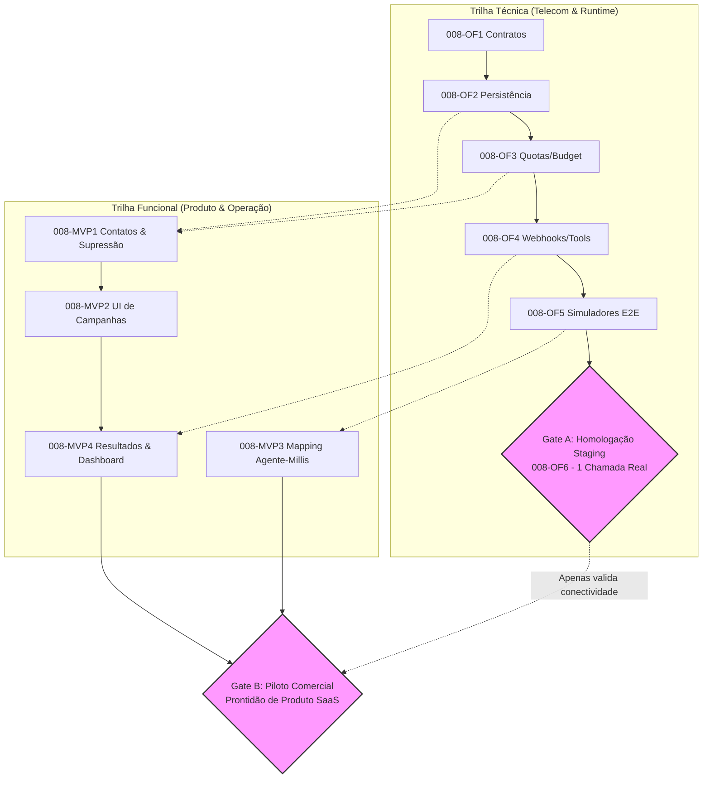

# Roteiro de Desenvolvimento do Produto (ROADMAP.md)

Este documento estabelece as fases sequenciais de implementação da plataforma. Esta ordem é a referência atual e pode conter subtarefas paralelas futuramente.

> **Revisado em**: 21 de Setembro de 2026 (PROMPT-001B)

---

## Fases de Implementação

### 📄 FASE 0 — Constituição e Documentação *(Concluída)*
- [x] Elaboração do [AGENTS.md](file:///D:/voice-agent-platform/AGENTS.md) com diretrizes operacionais para IAs.
- [x] Definição da [PROJECT_CONSTITUTION.md](file:///D:/voice-agent-platform/PROJECT_CONSTITUTION.md) com princípios inegociáveis.
- [x] Desenho da arquitetura geral e fluxo de processos no [ARCHITECTURE.md](file:///D:/voice-agent-platform/ARCHITECTURE.md).
- [x] Mapeamento dos pacotes e aplicações no [PROJECT_MAP.md](file:///D:/voice-agent-platform/PROJECT_MAP.md).
- [x] Elaboração dos Architecture Decision Records fundamentais (ADR-001 a ADR-006).
- [x] Criação do [FOUNDATION_MASTER.md](file:///D:/voice-agent-platform/FOUNDATION_MASTER.md) consolidado.
- [x] Criação do [AI_WORKLOG.md](file:///D:/voice-agent-platform/docs/AI_WORKLOG.md) como registro central obrigatório.
- [x] Revisão da fundação (PROMPT-001B): correção de decisões prematuras, incorporação de Agent Studio, versionamento de agentes, Knowledge Base, Agent Evals e Human Handoff.
- [ ] **Aprovação humana para transição de fase** *(pendente)*.

---

### 🏗️ FASE 1 — Arquitetura e Contratos *(Aguardando Aprovação)*
- Definição final das tecnologias pendentes (banco, ORM, cache, filas, cloud).
- Definição de interfaces de domínio abstratas (`TelephonyProvider`, `RealtimeAIProvider`, `StorageProvider`, etc.).
- Definição de schemas canônicos de eventos e DTOs compartilhados.

---

### 📦 FASE 2 — Monorepo e Tooling
- Setup da configuração de monorepo (workspace) e ferramentas de build.
- Criação dos pacotes compartilhados essenciais:
  - `packages/contracts`: Schemas canônicos e interfaces de domínio;
  - `packages/errors`: Catálogo padronizado de exceções;
  - `packages/logger`: Utilitário de logging estruturado;
  - `packages/config`: Validador de variáveis de ambiente;
  - `packages/test-utils`: Utilitários e fakes para testes.
- Configuração de linters e regras estritas de complexidade.

---

### 🎨 FASE 3 — Design System e Shell da Aplicação
- Implementação do `packages/ui` com biblioteca de design tokens e componentes adaptativos mobile-first.
- Aprovação final de tipografia, breakpoints e tokens visuais (atualmente "Proposed Default").
- Shell do dashboard B2B mobile-first estruturado para contemplar os dois contextos:
  - **Tenant Application**: Agentes, campanhas, histórico/ao vivo de chamadas, contatos, equipe e analytics;
  - **Platform Control Plane**: Organizações, planos, entitlements, concessões comerciais e auditoria da plataforma.
- *(Nota: Monitoramento ao vivo, gravações e handoff serão representados com dados mockados no shell visual; o funcionamento operacional real permanece atrelado às Fases 6 e 8).*

---

### 🗄️ FASE 4 — Persistência, Autenticação e Multi-Tenancy
- Decisão do banco de dados relacional e ORM/Query Builder.
- Modelagem das entidades centrais de tenant: `organizations`, `users`, `agents`, `contacts`, `calls`, `campaigns`.
- Implementação do sistema de migrações versionadas.
- Criação de Repositories tipados com validação mandatória de `organizationId`.
- Implementação do provedor de autenticação com segregação formal de `Platform Admin` global.
- **Subfase 4.1 — Modelo Comercial e Governança da Plataforma**:
  - Modelagem e persistência de `Plans`, `Entitlements`, `Subscriptions`, `CommercialGrants` e credenciais de `Platform Admin`;
  - Resolução dinâmica de capacidades por entitlements (sem condicionais hardcoded de plano);
  - *(Faturamento automatizado via gateway integrado poderá ser conectado posteriormente).*

---

### 🏪 FASE 5 — Domínios Base e Agent Studio
- Arquitetura aprovada formalmente (DEC-028, DEC-029, ADR-009, ADR-010).
- **Fatiamento Sequencial Aprovado**:
  - **005B**: Domain Core & Database Persistence (`Agent` e `AgentVersion`, schema Drizzle, PostgreSQL 16, migration, Repositories, validação Zod neutra em `packages/contracts`, concorrência `agents.max` com lock transacional).
  - **005C**: API Framework, Internal Auth & /v1 Endpoints (Hono para Node.js, `@hono/node-server`, `@hono/zod-openapi`, Short-Lived Asymmetric Signed Service Assertion, endpoints REST /v1).
  - **005D**: Frontend Agent Studio UI (Dashboard B2B em `apps/web`, editor de draft, publicação transacional).
- CRUD de organizações, usuários e controle de acesso (RBAC).
- Gestão de contatos e bases de discagem (subfases subsequentes).
- Catálogo determinístico de produtos e serviços (subfases subsequentes).
- Configuração e disparo de campanhas outbound (subfases subsequentes).

---

### 🎤 FASE 6 — Motor de Voz *(Concluída — Motor Offline 100% / PHASE6_STATUS = CLOSED)*
- [x] Implementação das portas `TelephonyProvider` e `RealtimeAIProvider`.
- [x] Criação de adaptadores de simulação/fake para desenvolvimento e testes sem custos.
- [x] Orquestração de pipeline de áudio bidirecional (WebSockets/SIP stream).
- [x] Implementação de VAD configurável e algoritmo de barge-in.
- [x] Mecanismo determinístico de execução de ferramentas (*tool calling*).
- [x] **Human Handoff Protocol**: Máquina de estados determinística (`NONE` → `REQUESTED` → `SELLER_NOTIFIED` → `SELLER_READY` → `AI_PREPARING` → `READY_TO_JOIN` → `HUMAN_CONNECTED` → `AI_DETACHED`) e fallbacks de indisponibilidade (Slice 006BQ).
- [x] **Live Call Telemetry**: Transmissão em tempo real de transcrição, eventos e telemetria de chamadas ativas.
- [x] **Parâmetros Operacionais de Produção**: Deferimento formal por decisão humana explícita de `PRODUCTION_JEV_TIMEOUT_MS`, `PRODUCTION_SHADOW_MAX_CONCURRENCY` e `PRODUCTION_ACTIVE_GUARDED_MAX_CONCURRENCY` para a Fase 10 (Slice 006BR / DEC-038).

---

### 🤖 FASE 7 — Agente IA e Tools *(Concluída e Validada na Main — Fechamento Formalizado por Aceitação Humana)*
- API Core e orquestração outbound (`apps/api`).
- Definição e implementação das tools disponíveis para agentes.
- Versionamento de agentes: ciclo canônico DRAFT → PUBLISHED → ARCHIVED (supersedendo o ciclo anterior com TEST como status persistente; TEST é atividade pontual de validação — DEC-028 / ADR-009).
- Knowledge Base: integração de dados estruturados (determinístico) e não estruturados (RAG — arquitetura definida via ADR-020; vetores e embeddings deferidos).
- **Fatiamento Sequencial da Fase 7**:
  - [x] **Slice 007A — Universal Tool Execution Engine & Runtime Context** (PR #94 / Merged): Motor universal `ToolExecutionEngine`, `InMemoryToolRegistry`, isolamento de contexto e validação via Zod.
  - [x] **Slice 007B — Catalog Business Data Domain & Deterministic Tools** (PR #95 / Merged): Schema `catalog_items` (migration `0002_silent_squadron_sinister.sql`), `CatalogRepository`, `CatalogSearchTool` e `CatalogItemDetailTool`.
  - [x] **Slice 007C — Agent Studio Toolset Configuration** (PR #96 / Merged): Edição de ferramentas autorizadas no Agent Studio (`apps/web`), snapshot JSONB tipado em `agent_versions.configuration`.
  - [x] **Slice 007D — Outbound Campaigns Domain, Worker Dispatcher & Scheduling** (PR #105 / Merged): Schema `outbound_campaigns` e `outbound_call_jobs` (migration `0003_tiresome_nemesis.sql`), rotas `/v1/campaigns`, dispatcher atômico com `SKIP LOCKED` e bootstrap de chamadas de voz.
  - [x] **Slice 007E — Call Handoff State Machine & Offline Contracts** (PR #106 / Merged): Máquina de estados determinística de handoff humano e contratos offline de transferência.
  - [x] **Slice 007F — Knowledge Base Domain & Neutral Contracts** (PR #108 / Merged): Contratos de documentos, chunks, escopos de acesso e portas de retrieval neutras em `packages/contracts`.
  - [x] **Slice 007G / 007H — Knowledge Base Persistence, Ingestion & Retrieval Runtime** (PR #110 / Merged): Schemas `knowledge_documents` e `knowledge_chunks` (migrations `0004_ordinary_charles_xavier.sql` e `0006_peaceful_thunderbolt.sql`), `KnowledgeDocumentRepository`, ingestão atômica de texto confiável local com normalização NFC e hashing SHA-256, e retrieval léxico offline delimitado por tenant.
  - [x] **Slice 007I — Agent Version Draft Discard & Published Version Lock** (PR #107 / Merged / DEC-040) e **Offline Voice Knowledge Handoff** (PR #111 / Merged): Rota `POST /v1/agents/:agentId/versions/draft/discard` preservando imutabilidade de versões publicadas, e coordenador offline `VoiceKnowledgeRetrievalCoordinator`.
  - [x] **Slice 007J — Knowledge Base API Management** (PR #112 / Merged / DEC-039): Rotas REST autenticadas `/v1/knowledge/documents` (POST ingest, GET list, GET detail, POST archive) com autorização RBAC dedicada (`knowledge.read`, `knowledge.ingest`, `knowledge.archive`), paginação delimitada e proteção anti-enumeração.
  - [x] **Slice 007K — Knowledge Base Studio UI & BFF** (PR #113 / Merged): Interface web completa no Agent Studio (`apps/web`), rotas BFF `/api/knowledge-documents` com asserções criptográficas Ed25519 de curta duração, controle de concorrência otimista (`If-Match`/`ETag` e update atômico condicional), proteção CSRF fail-closed para `X-Forwarded-Host`, consistência multi-aba via `x-knowledge-org-slug` e interface acessível e responsiva.
  - [x] **Slice 007L — Governance Closure & Phase 8 Readiness** (PR #114 / Merged na Main em 461f37e / Post-Merge Gate PASS): Reconciliação documental completa de governança, histórico factual de 007K e 005D atualizado, Phase 7 formalmente concluída por aceitação humana formal (DEC-041).

- **Escopo Entregue na Fase 7**:
  - Motor universal de ferramentas e resolução de toolset por versão publicada;
  - Domínio de catálogo determinístico, ferramentas de busca e detalhe de itens;
  - Campanhas outbound com agendamento em lote e despacho atômico assíncrono;
  - Máquina de estados determinística de handoff para operador humano e contratos offline;
  - Descarte seguro de rascunhos de versão mantendo integridade e imutabilidade de versões publicadas (DEC-040);
  - Persistência e repositórios de base de conhecimento com migrações versionadas (0004 e 0006);
  - Ingestão atômica de texto estrito NFC e busca léxica offline delimitada por tenant;
  - API HTTP autenticada com RBAC estrito (`knowledge.*`) e segregação de autoridade (gestão humana vs. retrieval do agente);
  - Interface do Agent Studio com gerenciamento de documentos e rotas BFF com asserções assimétricas Ed25519 e blindagem CSRF.

- **Capacidades Explicitamente Deferidas (Fora do Escopo da Fase 7)**:
  - Busca vetorial semântica e embeddings reais (`pgvector`, modelos de embedding pagos ou dedicados);
  - Ativação de RAG em runtime de produção e injeção em prompts de chamadas reais;
  - Ingestão de binários (PDFs, DOCX), arquivos de áudio e raspadores web (crawlers);
  - Conexão telefônica real e discagem por carriers (escopo estrito da Fase 8);
  - Integração com sistemas de CRM e calendários externos (escopo estrito da Fase 8);
  - Testes visuais E2E reais de navegador (deferidos; suíte executada com fakes/mocks);
  - Deploys de staging/produção para a nova API de Knowledge Base e novos serviços.

---

### 📞 FASE 8 — Telefonia Real *(Arquitetura e Planejamento Formalizados — DEC-042)*
- **Provedor de Telefonia**: Twilio selecionada formalmente (DEC-042) exclusivamente com números gerenciados para originação outbound. Suporte a BYON (Bring Your Own Number) formalmente cancelado.
- **Plataforma Conversacional de Voz**: Millis AI selecionada (DEC-042) para conversação em tempo real (STT, LLM, TTS, configuração de agentes e funções externas).
- **Código Offline Preservado**: Integração com Twilio ConversationRelay preservada intacta em `packages/integrations` (inativa; sem fiação em produção).
- **Divisão Arquitetural de Responsabilidades (DEC-042)**:
  - **Voice Agent Platform**: Multi-tenancy, Agent Studio, Knowledge Base, CRM e tools, campanhas outbound, agendamento de jobs, quotas, billing e controle financeiro.
  - **Twilio**: Telefonia, originação de chamadas, números gerenciados, transporte telefônico.
  - **Millis AI**: Conversação em tempo real, STT, LLM, TTS, configuração de agentes, webhooks e funções externas conforme contratos oficiais validados.
- **Outras Escolhas de Planejamento Reconciliadas**: Hostinger VPS (hospedagem futura planejada), Supabase (PostgreSQL gerenciado futuro planejado), Cloudflare R2 (armazenamento de arquivos e gravações privadas planejado).
- **Itens Classificados Obrigatoriamente como `NOT_VERIFIED`**:
  - Disponibilidade de números brasileiros Twilio.
  - Possibilidade real de integração outbound Twilio + Millis no Brasil.
  - Contratos de webhooks e mecanismo de autenticação da Millis.
  - Cobranças por tentativas sem atendimento.
  - Tarifas efetivas para fixo, celular e prefixo 0303.
  - Regras regulatórias brasileiras de telecomunicações.
  - Transferência de chamadas para humanos.

#### 1. Fatiamento Histórico Original da Fase 8 (Baseline de Referência 008A–008G)
- [ ] **Slice 008A — Phase 8 Architecture Foundation, Port Definitions & Webhook Security Ingress (Planning & Foundation)**:
  - Formalização documental e arquitetural das Portas de integração: `TelephonyProviderPort`, `RecordingStoragePort`, `HumanHandoffBridgingPort`.
  - Design e especificações de segurança do Webhook Ingress para staging (Twilio `X-Twilio-Signature`; Millis classificada como `NOT_VERIFIED`).
  - Isolamento orçamentário mandatório e definição de Hard Budget Caps.
- [ ] **Slice 008B — Real Telephony Provider Adapter & Inbound Gateway Execution**:
  - Implementação concreta do adapter do carrier selecionado (Twilio) em `packages/integrations` (mantendo o core estritamente provider-neutral).
  - Gateway de entrada de chamadas (`InboundCallGateway`) mapeando DIDs para `organizationId` e versão publicada ativa do agente.
- [ ] **Slice 008C — Call Recording Ingestion & Tenant-Isolated Object Storage**:
  - Implementação do adapter de Object Storage (Cloudflare R2 planejado) em `packages/integrations`.
  - Ingestão de áudio pós-chamada com isolamento estrito por tenant e signed URLs.
- [ ] **Slice 008D — Live Human Handoff Bridging**:
  - Conexão da máquina de estados determinística (Slice 007E / 006BQ) com o bridging telefônico real.
- [ ] **Slice 008E — Outbound Live Carrier Dialer Integration**:
  - Conexão do dispatcher assíncrono de campanhas (Slice 007D) com a porta de discagem do carrier real.
  - Concorrência, rate-limiting e detecção de secretária eletrônica (AMD).
- [ ] **Slice 008F — External Business Adapters (CRM & Calendar)**:
  - Adapters provider-neutral para sincronização de contatos, eventos e resumos pós-chamada.
- [ ] **Slice 008G — Staging Telephony Validation, Security Audit & Phase 8 Closure**:
  - Testes controlados em ambiente de staging com números de teste e créditos orçamentários delimitados.

---

#### 2. Planejamento Outbound-First em Duas Trilhas: Fundação Técnica e MVP Funcional (DEC-043)

> **Status do Planejamento**: `APPROVED (DEC-043) / IMPLEMENTATION_PENDING_SEPARATE_AUTHORIZATION` (Aprovado formalmente pelo operador humano em 2026-10-19; estabelece a prioridade `OUTBOUND_FIRST`, o sequenciamento técnico `008-OF1` a `008-OF6`, a trilha funcional `008-MVP1` a `008-MVP4` e a segregação estrita entre homologação técnica em staging e prontidão de piloto comercial).

##### A. Justificativa Técnica do Refatiamento
A ordem histórica 008A–008G postergava o dialer outbound para o Slice 008E, condicionando-o à construção prévia de recepção inbound (008B), storage de gravações (008C) e transbordo humano (008D). Como o objetivo central prioritário da plataforma no lançamento é a realização de **chamadas ativas outbound** (DEC-042), esta proposta antecipa os componentes essenciais de discagem e adia funcionalidades não-bloqueantes para após a validação do fluxo principal.

##### B. Princípios Arquiteturais e Ajustes Mandatórios da Proposta

1. **Autoridade Única de Originação (Provider-Neutral)**:
   - A interface de comando (`TelephonyOriginationPort`) permanece estritamente neutra em relação a provedores.
   - Foram avaliadas as duas opções de acionamento:
     - **Opção A (Millis-Led)**: Plataforma aciona Millis AI, que utiliza a infraestrutura/número Twilio configurado.
     - **Opção B (Twilio-Led)**: Plataforma inicia a chamada na Twilio e conecta o áudio à Millis AI por integração de mídia suportada.
   - Ambas as opções permanecem classificadas como **`PROVIDER-UNVERIFIED`** para operação real no Brasil (+55).
   - O projeto **não** assume `TwilioOutboundOriginationAdapter` como implementação definitiva obrigatória antes de o operador selecionar formalmente a opção.
   - **Invariante Mandatória**: **Uma única autoridade de originação por tentativa de discagem**. É terminantemente proibido disparar comandos concorrentes para Twilio e Millis para o mesmo destinatário.

2. **Separação Explícita de Entidades de Estado Durável**:
   - Os schemas existentes (`outbound_campaigns` e `outbound_call_jobs`) não devem acumular responsabilidades de execução em tempo real. A persistência operacional separa explicitamente:
     - *Job de Campanha* (`outbound_call_jobs`): intenção de agendamento e destinatário.
     - *Tentativa de Discagem* (`call_attempts`): registro monotônico de cada disparo (1, 2, 3), timestamp e resultado isolado da tentativa.
     - *Sessão de Chamada* (`call_sessions`): estado em tempo real da chamada em andamento.
     - *Referências Externas* (`provider_call_id`, `provider_leg_id`): identificadores duráveis atribuídos pelos provedores externos.
     - *Eventos Recebidos* (`call_events`): log auditável de webhooks e transições, com separação explícita entre deduplicação de entrega de rede, ordenação de máquina de estados e idempotência de efeitos de negócio, e minimização de dados pessoais.
     - *Custos e Liquidações* (`outbound_budget_ledgers`): controle de reservas pré-chamada e liquidação pós-chamada.

3. **Recuperação de Crash e Proteção contra Rediscagem Cega**:
   - Cenário de falha considerado: Worker persistiu a intenção de discagem -> enviou comando externo ao provedor -> provedor iniciou a chamada -> worker sofreu crash/reinício antes de registrar a resposta.
   - **Protocolo de Recuperação**: Na recuperação, tentativas sem desfecho conhecido entram em estado transitório `OUTCOME_UNKNOWN` / `PENDING_RECONCILIATION`.
   - É **proibida a rediscagem cega imediata** (evitando múltiplas chamadas simultâneas ao mesmo cliente).
   - O worker executa reconciliação idempotente consultando o provedor ou aguarda webhooks de encerramento com timeout delimitado antes de liberar nova tentativa.
   - A chave de idempotência interna (`idempotencyKey`) não é tratada como garantia suficiente de deduplicação sem validação contratual do provedor.

4. **Orçamento, Quotas e Governança Financeira Fail-Closed**:
   - A premissa de *até 50 tentativas outbound por tenant/dia* é estritamente uma **referência de dimensionamento inicial de planejamento**, não um limite implementado nem uma autorização de chamadas reais.
   - O valor de US$ 20 para staging é meramente ilustrativo, pendente de teto formal aprovado.
   - O plano exige:
     - Hard budget caps por tenant e global;
     - Limite de duração máxima por chamada com corte automático de segurança;
     - Reserva conservadora atômica de saldo estimado antes de emitir a ordem de discagem;
     - Separação contábil estrita entre custos de carrier (Twilio) e custos conversacionais (Millis AI);
     - Reconciliação tardia e estorno de saldos reservados não consumidos na finalização da chamada;
     - Limites rígidos de concorrência por organização (`max_concurrent_calls`) e retries por contato;
     - **Princípio Fail-Closed**: Se o saldo ou os limites não puderem ser confirmados atomicamente, a discagem é terminantemente bloqueada.

5. **Segurança de Webhooks e Contratos da Millis AI**:
   - Proibida a presunção de suporte a HMAC, payloads específicos, URLs ou timeout de 2 segundos para a Millis AI sem contratos oficiais validados.
   - Toda integração futura exigirá autenticação formal comprovada, resolução de `organizationId` exclusivamente server-side, priorização de identificadores oficiais estáveis do provedor (com estratégia determinística para ausência de IDs confiáveis e `payloadHash` como evidência auxiliar), proteção contra replay, eventos duplicados e eventos ambíguos, preservação de transições monotônicas sem efeitos colaterais financeiros duplicados, e rejeição fail-closed (HTTP 401/403).
   - Webhooks públicos permanecem bloqueados até a homologação em staging.

6. **Elegibilidade de Contatos e Legislação Brasileira**:
   - Janelas de discagem são tratadas como **política configurável do tenant dependente de validação regulatória**, e não como regra universal aprovada (o intervalo 09h–20h BRT não constitui autorização legal universal).
   - Permanecem catalogados como **`NOT_VERIFIED`**: aplicabilidade das normas da Anatel sobre telemarketing ativo, prefixo 0303, regras de chamadas curtas (abaixo de 3 segundos), identificação de número de origem e consentimento de gravação (LGPD).

---

##### C. Tabela de Correspondência entre Slices Históricas e Proposta Nova

| ID Original | Escopo Original | Novo ID Proposto | Novo Escopo Priorizado (Outbound-First) | Status na Nova Ordem |
| :---: | :--- | :---: | :--- | :--- |
| **008A** | Fundação Geral & Ingress Webhooks | **008-OF1** | **Contratos e Ciclo de Vida Outbound Provider-Neutral** | Slice 1 (Imediata / Offline) |
| **008E** (parte) | Persistência de Discador | **008-OF2** | **Persistência Operacional e Números Twilio** | Slice 2 (Offline / Migrations) |
| **008A / 008E** | Quotas e Limites de Discagem | **008-OF3** | **Quotas, Concorrência e Orçamento (Hard Budget)** | Slice 3 (Offline / Guardrails) |
| **008A** (refinado) | Webhook Ingress | **008-OF4** | **Webhooks e Integração de Ferramentas Offline** | Slice 4 (Offline / Fakes) |
| **008E** (conclusão) | Integração Real de Carrier | **008-OF5** | **Integração Twilio + Millis com Simuladores E2E** | Slice 5 (Offline / Adapters) |
| **008G** | Staging Validation | **008-OF6** | **Homologação Controlada em Staging (1 Chamada Real)** | Slice 6 (Live sob autorização) |
| **008B** | Adapter Telefônico & Inbound Gateway | **008-POST1** | *Recepção Telefônica Inbound* | Postergada (Pós-Outbound MVP) |
| **008C** | Call Recording Ingestion & R2 | **008-POST2** | *Ingestão de Gravações Privadas em R2* | Postergada (Pós-Outbound MVP) |
| **008D** | Human Handoff Bridging ao Vivo | **008-POST3** | *Transbordo Telefônico para Operador Humano* | Postergada (Pós-Outbound MVP) |
| **008F** | CRM & Calendar Integrations | **008-POST4** | *Integrações com CRM e Calendário* | Postergada (Pós-Outbound MVP) |

*Nota de Preservação*: Nenhuma capacidade funcional existente foi removida ou descartada. As slices `008-POST1` a `008-POST4` mantêm seus requisitos preservados e serão executadas sequencialmente após a estabilização do MVP outbound.

---

##### D. Detalhamento Sequencial das Slices Outbound-First

- [x] **Slice 008-OF1 — Contratos e Ciclo de Vida Outbound Provider-Neutral (Fundação)**:
  - **Status Real**: Concluída e mesclada na `main` via PR #119 (`fb82e40da61006c798860b1bb9c320ed255b1cde`). Contratos em `packages/contracts/src/telephony/`; coordenador e fakes offline em `apps/worker/src/`; zero migrations, zero adapters Twilio/Millis em produção, zero chamadas reais (`PROVIDER-UNVERIFIED`). Persistência e tolerância a crash entregues na 008-OF2.
  - **Objetivo**: Definir portas de originação, estados de tentativa e ciclo de vida de chamadas outbound sem acoplamento a fornecedores e sem migrations prematuras.
  - **Escopo**:
    - Porta `TelephonyOriginationPort` e tipos em `packages/contracts/src/telephony/`.
    - Máquina de estados de tentativas com suporte a estados transitórios (`OUTCOME_UNKNOWN`) e desfechos determinísticos.
    - Fakes e simuladores offline em memória para testes do ciclo de vida.
    - Zero migrations nesta slice (nenhuma dependência de banco novo).
  - **Dependências**: Nenhuma (executável imediatamente sobre a base atual da `main`).
  - **Arquivos Prováveis**: `packages/contracts/src/telephony/`, `apps/worker/src/`, `apps/voice/src/`.
  - **Testes Offline**: Testes unitários de transição de estado, validação de inputs e simulações de fluxo de chamada.
  - **Critérios de Aceitação**: Portas implementadas, suite de testes passando, `pnpm check` = exit 0, zero dependências externas.
  - **Riscos**: Acoplamento prematuro a conceitos específicos da Twilio ou Millis (mitigado por revisão provider-neutral).

- [x] **Slice 008-OF2 — Persistência Operacional, Sessões, Eventos e Números Twilio**:
  - **Status Real**: Concluída e mesclada na `main` via PR #121 (`e1203381374b1d372b98cf0f049237fe7c5378ac`). Migration aditiva `0007_durable_outbound_persistence.sql` aplicada exclusivamente em PostgreSQL 16 local descartável; schemas `organization_phone_numbers`, `call_attempts`, `call_sessions`, `call_events`; FKs compostas por tenant; triggers append-only e de imutabilidade; repositories transacionais; leases/fencing e suíte de recuperação de crash com processos Node reais. Zero migrations remotas, zero chamadas reais, zero compra de números (`PROVIDER-UNVERIFIED`).
  - **Objetivo**: Estabelecer a fundação completa de persistência durável para o ciclo de vida outbound, mapeando números Twilio e separando explicitamente jobs, tentativas, sessões e eventos.
  - **Escopo**:
    - Planejamento de migration aditiva versionada para tabela `organization_phone_numbers` (`organizationId`, `e164Number`, `twilioPhoneNumberSid`, `status: ACTIVE | RELEASED`).
    - Planejamento de migration aditiva versionada para tabela `call_attempts` (`id`, `jobId`, `organizationId`, `attemptNumber`, `providerCallId`, `status: PENDING | DISPATCHED | OUTCOME_UNKNOWN | FAILED | COMPLETED`, timestamps, erro).
    - Planejamento de migration aditiva versionada para tabela `call_sessions` (`callId`, `organizationId`, `agentId`, `agentVersionId`, `runtimeState`, `currentAttemptId`, `startedAt`, `endedAt`, `failureReason`), garantindo associação inequívoca Tentativa ↔ Sessão ↔ Provedor.
    - Planejamento de migration aditiva versionada para tabela `call_events` (`id`, `organizationId`, `callId`, `provider`, `providerCallId`, `providerEventId`, `eventType`, `payloadHash`, `receivedAt`, `processedAt`):
      - Identidade do evento associada estritamente ao provedor, à conta autorizada (`organizationId`) e à sessão/tentativa correspondente.
      - Priorização de identificadores oficiais estáveis fornecidos pelo provedor (`providerEventId`), quando contratualmente verificados (`PROVIDER-UNVERIFIED` até homologação formal).
      - `payloadHash` como evidência auxiliar de integridade de transporte e replay, e não como garantia única de identidade de negócio.
      - Minimização de dados pessoais (PII): armazenamento estrito de metadados operacionais e identificadores técnicos necessários para auditoria, ordenação e reconciliação.
      - Separação conceitual durável entre: (a) deduplicação de entrega na borda, (b) ordenação monotônica de eventos e (c) idempotência de efeitos de negócio.
    - Repositórios com isolamento estrito multi-tenant e queries tipadas.
    - *Nota*: Nenhuma migration é criada nesta tarefa de planejamento documental.
  - **Dependências**: Conclusão da Slice 008-OF1.
  - **Arquivos Prováveis**: `packages/database/src/schema/`, `packages/database/src/repositories/`.
  - **Testes Offline**: Testes de persistência em PostgreSQL local (Docker) validando integridade referencial, foreign keys compostas por tenant, índices únicos e isolamento estrito entre organizações.
  - **Critérios de Aceitação**: Schemas aditivos e repositórios testados localmente; modelo durável capaz de representar tentativas, sessões e eventos com rastreabilidade auditável e minimização de dados; zero queries raw em controllers; isolamento multi-tenant comprovado.
  - **Riscos**: Colisão de números entre tenants (mitigado por unique index em `e164Number`).

- [x] **Slice 008-OF3 — Quotas, Concorrência e Orçamento (Hard Budget Caps)**:
  - **Status Real**: Concluída, testada offline e mesclada na `main` via PR #122 (`f7b19ee13bab99aabf247b94245924b42736d349`) com hardening fail-closed subsequente nas PRs #123 e #124 (liberação de orçamento condicionada a prova de não envio, com cancelamento atômico da tentativa; janela diária correta em dias de DST; fuso inválido fail-closed; testes adversariais com 2/10/100 competidores e reinício de processo). Contratos de domínio provider-neutral em `packages/contracts/src/telephony/outbound-budget-*`; migrations aditivas versionadas `0008_outbound_budget_quotas.sql` com tabelas `platform_global_budget_ledgers`, `outbound_budget_ledgers` e `outbound_budget_reservations`; travas atômicas `SELECT ... FOR UPDATE` ordenadas global → tenant com solvency guard, daily quotas timezone-aware e limite de concorrência simultânea fail-closed; separação contábil estrita entre custos de carrier e conversacionais (`carrier` e `conversational`); `DurableGuardedOriginationRunner` garantindo unencumber/estorno imediato em origination abortada e bloqueando reservas não pendentes; `pnpm check` aprovado integralmente com zero erros.
  - **Objetivo**: Implementar travas financeiras atômicas e de concorrência antes da autorização de qualquer discagem.
  - **Escopo**:
    - Tabela e repositório de ledger: `outbound_budget_ledgers` (saldo, reserva pendente, consumo consolidado).
    - Tabela e repositório de reservas: `outbound_budget_reservations` (reserva atômica idempotente pré-chamada com estorno pós-chamada).
    - Limite de chamadas simultâneas por organização (`max_concurrent_calls`).
    - Verificação de quota diária (premissa de planejamento delimitada) e bloqueio fail-closed.
  - **Dependências**: Conclusão das Slices 008-OF1 e 008-OF2.
  - **Arquivos Implementados**: `packages/contracts/src/telephony/outbound-budget-*`, `packages/database/src/schema/outbound-budget-*`, `packages/database/src/repositories/outbound-budget-*`, `packages/database/src/repositories/durable-guarded-origination-runner.ts`, `packages/database/src/migrations/0008_outbound_budget_quotas.sql`.
  - **Testes Offline**: Testes unitários puros de contratos e avaliação de saldo em `@voice-agent/contracts`; testes de integração em PostgreSQL 16 Docker simulando concorrência simultânea de múltiplos workers, esgotamento atômico de saldo, bloqueio fail-closed de quota diária e idempotência.
  - **Critérios de Aceitação**: Impossibilidade comprovada de saldo negativo em testes de estresse, fail-closed verificado, suite de testes passando, `pnpm check` = exit 0, zero dependências externas.
  - **Riscos Mitigados**: Concorrência de saldo prevenida por transações `SELECT ... FOR UPDATE` curtas, ordenação e idempotência atômica por tentativa/chave.

- [x] **Slice 008-OF4 — Webhooks e Integração de Ferramentas Offline**:
  - **Status Real**: Implementada offline na branch `feat/phase8-008-of4-secure-webhooks` (PR pendente de merge). Contratos provider-neutral em `packages/contracts/src/telephony/provider-webhook-contracts.ts` (autenticador fail-closed por padrão, normalizador por provedor, schema estrito sem campos de tenant); ingress em `apps/api/src/webhooks/` **não montado** em `createApp` (webhooks públicos = 0); resolução server-side do tenant por `call_attempts.provider_reference` (migration aditiva `0009_provider_reference_lookup`, apenas índice); deduplicação por `event_id` determinístico (id oficial ou chave composta), trilha `source = PROVIDER` com hash do corpo; nenhum efeito financeiro a partir de webhooks (semântica de custo de rejeições `PROVIDER-UNVERIFIED`; liquidação/reconciliação em 008-OF5/008-MVP4); despacho de ferramentas via `ToolPort` com timeout interno fail-closed. Contratos reais Twilio/Millis: `PROVIDER-UNVERIFIED` (008-OF5).
  - **Objetivo**: Construir a recepção segura de eventos e despacho de ferramentas determinísticas para a plataforma conversacional, consumindo as tabelas de sessão e eventos da Slice 008-OF2.
  - **Escopo**:
    - Endpoints de webhook em `apps/api` para status de chamada e acionamento de ferramentas.
    - Mecanismo de autenticação fail-closed simulado (sem presumir HMAC; token/header verificado conforme contrato oficial a ser homologado).
    - Resolução server-side autoritativa de organização baseada no `callId` / sessão durável, prevenindo injeção de parâmetros de tenant em payloads externos.
    - Política de deduplicação, ordenação e idempotência em camadas consumindo `call_events` da 008-OF2:
      - *Deduplicação de Entrega*: Priorização de identificadores oficiais estáveis fornecidos pelo provedor (`providerEventId`), quando contratualmente verificados; quando ausente event ID confiável, adoção de estratégia determinística composta (provedor + tenant + tentativa/sessão + tipo de evento + transição de estado) documentada, testada e compatível com o contrato real do provedor, sem presumir campos inexistentes; `payloadHash` como evidência auxiliar de integridade.
      - *Ordenação e Monotonicidade*: Preservação estrita de transições monotônicas de estado (rejeição de regressão de estados terminais por eventos atrasados ou fora de ordem).
      - *Idempotência de Efeitos de Negócio*: Garantia de que eventos repetidos não provocam efeitos colaterais financeiros duplicados no ledger nem alterações repetidas de ciclo de vida.
      - *Tratamento de Eventos Ambíguos*: Eventos sem correspondência inequívoca ou com dados conflitantes entram em quarentena/log auditável e **nunca** provocam nova discagem nem liquidação financeira duplicada.
      - *Mecanismos do Provedor*: Mantidos como `PROVIDER-UNVERIFIED` até homologação com contratos oficiais (sem suposição de schemas oficiais da Millis AI).
    - Despacho determinístico para o `ToolExecutionEngine` existente em `apps/voice`.
    - Política de timeout tecnicamente neutra: timeout interno configurável para execução de ferramentas; valor definitivo dependente do contrato oficial da Millis AI; fail-closed quando o limite for excedido; sem presunção de SLA ou timeout oficial não verificado.
  - **Dependências**: Conclusão das Slices 008-OF1 a 008-OF3.
  - **Arquivos Prováveis**: `apps/api/src/routes/`, `apps/voice/src/tool-execution-engine.ts`.
  - **Testes Offline**: Testes HTTP simulando payloads forjados, eventos duplicados exatos, entrega repetida com e sem `providerEventId`, eventos fora de ordem, eventos ambíguos (comprovando zero rediscagem e zero efeito financeiro duplicado), simulações de timeout interno, cancelamento e falha de execução.
  - **Critérios de Aceitação**: Rejeição 401/403 comprovada para dados não autenticados; deduplicação efetiva e idempotência de efeitos de negócio comprovadas; preservação de transições monotônicas; resolução de tenant inviolável; tratamento fail-closed de timeout interno e de eventos ambíguos comprovado em testes automatizados.
  - **Riscos**: Latência de rede externa na resposta de ferramentas (mitigado por timeout interno configurável e cancelamento assíncrono).

- [ ] **Slice 008-OF5 — Integração Twilio + Millis com Simuladores E2E**:
  - **Objetivo**: Desenvolver os adaptadores concretos de integração desacoplados em `packages/integrations` com simuladores de ponta a ponta.
  - **Escopo**:
    - Adaptador concreto de originação conforme a opção de autoridade aprovada pelo operador.
    - Adaptador de conversação Millis AI conectando ferramentas determinísticas e controle de sessão.
    - Simuladores offline robustos (`FakeTwilioOriginationSimulator`, `FakeMillisConversationSimulator`).
    - Preservação integral e intocada do código existente de Twilio ConversationRelay.
  - **Dependências**: Conclusão das Slices 008-OF1 a 008-OF4.
  - **Arquivos Prováveis**: `packages/integrations/src/`, `apps/worker/src/`.
  - **Testes Offline**: Suíte de testes E2E executada 100% offline simulando desde a criação da campanha até a finalização e reconciliação da chamada.
  - **Critérios de Aceitação**: Fluxo ponta a ponta aprovado localmente, classificação formal de adaptadores como `PROVIDER-UNVERIFIED`.
  - **Riscos**: Incompatibilidade entre simulador e comportamento real dos provedores (mitigado por isolamento rígido em adapters).

- [ ] **Slice 008-OF6 — Homologação Controlada em Staging (1 Chamada Real)**:
  - **Objetivo**: Comprovar a integração real com uma única chamada supervisionada de teste em staging, mediante autorização humana expressa.
  - **Escopo**:
    - Execução supervisionada de 1 única chamada de teste para telefone autorizado pertencente ao operador humano.
    - Verificação de latência, áudio, execução de 1 ferramenta real, encerramento e liquidação no ledger financeiro.
  - **Bloqueios Obrigatórios Anteriores a Qualquer Teste Real (Nenhum considerado satisfeito apenas pela conclusão das slices offline)**:
    1. Compatibilidade técnica outbound Twilio + Millis AI para prefixos brasileiros (+55) formalmente comprovada.
    2. Disponibilidade e elegibilidade de número Twilio apropriado (+55 móvel ou fixo) com documentação regulatória aprovada no console Twilio.
    3. Contratos oficiais e modelo de autenticação de webhooks da Millis AI formalmente homologados.
    4. Reconciliação financeira e ledger operacional funcional com comprovação em testes offline prévios.
    5. Hard budget cap formalmente aprovado e fixado pelo operador humano (o valor ilustrativo de US$ 20 não constitui autorização).
    6. Verificação de conformidade regulatória (Anatel / telemarketing / 0303) e jurídica (LGPD / consentimento de gravação) aplicável.
    7. Infraestrutura de staging segregada e segura com terminação TLS e FQDN público verificado.
    8. Número de destino de teste expressamente autorizado e pertencente ao operador humano.
    9. Autorização humana adicional, específica e prévia para compra de número, carga de créditos e disparo da chamada.
  - **Salvaguardas Preservadas**: `CUSTOMER_TRAFFIC = PROHIBITED`, `ACTIVE_GUARDED = BLOCKED`, `PRODUCTION_RUNTIME_WIRING = NO`, `REAL_PROVIDER_CALLS = 0`, `PURCHASE_OF_PHONE_NUMBERS = 0`.
  - **Dependências**: Conclusão e validação estrita das Slices 008-OF1 a 008-OF5 e liberação explícita de todos os bloqueios obrigatórios acima.
  - **Critérios de Aceitação**: Relatório factual de execução com logs sanitizados (dados telefônicos mascarados, sem PII) e confirmação de sucesso de ponta a ponta.

---

##### E. Trilha Funcional de MVP Outbound (008-MVP1 a 008-MVP4)

Esta trilha paralela e rastreável define as capacidades de produto indispensáveis para que a plataforma seja operada por clientes em um piloto comercial, segregando a entrega de software utilizável da infraestrutura básica de telefonia:

- [x] **Slice 008-MVP1 — Contatos, Audiência, Supressão e Elegibilidade**:
  - **Status Real**: Implementada offline na branch `feat/phase8-008-mvp1-contacts-suppression` (PR pendente). Contratos em `packages/contracts/src/contacts/` (normalização E.164 pelo plano de numeração brasileiro — DDDs geográficos, móvel 9 dígitos/fixo 8 dígitos, não geográficos recusados —, parser CSV RFC 4180 com limites, relatório de rejeição neutralizado contra CSV injection, supressões sem presunção legal); migration aditiva `0010_contacts_audiences_suppression` (`contacts`, `contact_lists`, `contact_list_members` com FKs compostas por tenant, `contact_suppressions`) + trigger que impede criar/redirecionar job para número suprimido; guarda de supressão no `claimSend` (cancela a tentativa atomicamente e permite liberar a reserva); rotas `/v1/contact-lists*` e `/v1/contact-suppressions` com RBAC próprio. *Diferido*: janelas/políticas de horário de contato por tenant (008-MVP2, junto ao agendamento) e remoção de supressão (exige decisão de governança).
  - **Objetivo**: Permitir que o cliente gerencie seus destinatários de campanhas com isolamento multi-tenant, validação estrita e conformidade regulatória prévia.
  - **Escopo**:
    - Modelagem e persistência de contatos permanentes (`tenant_contacts`) isolados por `organizationId`.
    - Agrupamento em listas e audiências segmentadas (`contact_lists`, `contact_list_members`).
    - Mecanismo de importação inicial via arquivos CSV com mapeamento flexível de colunas (Nome, Telefone, Variáveis customizadas).
    - Validação e higienização determinística de números telefônicos (+55 padrão E.164, móvel e fixo).
    - Deduplicação determinística de contatos por organização.
    - Gestão de listas de supressão (*Não Perturbe* / Procon / opt-out) e bloqueio fail-closed de números inelegíveis.
    - Registro de evidências de consentimento e base legal quando aplicável.
    - Definição de janelas e políticas de horários de contato configuráveis por tenant (sem presumir regra legal universal).
    - *Nota de Escopo*: Importação Excel, enriquecimento de leads e campos dinâmicos complexos ficam diferidos para fases posteriores.
  - **Dependências**: Slices 008-OF2 (persistência de números/sessões) e 008-OF3 (quotas e limites).
  - **Arquivos Prováveis**: `packages/database/src/schema/contacts.ts`, `apps/api/src/routes/contacts-routes.ts`.
  - **Testes Offline**: Testes de validação de números telefônicos brasileiros, importação CSV em lote, bloqueio por lista de supressão e isolamento de tenant.
  - **Critérios de Aceitação**: Importação de CSV validada com relatório de linhas rejeitadas; impossibilidade comprovada de inclusão de número suprimido em jobs de campanha; zero vazamento entre tenants.

- [ ] **Slice 008-MVP2 — Interface de Gestão de Campanhas e Operações**:
  - **Objetivo**: Permitir ao cliente criar, operar, pausar e acompanhar campanhas outbound diretamente pelo painel web, eliminando a dependência de chamadas diretas de API.
  - **Escopo**:
    - Interface visual em `apps/web` para criação, edição e monitoramento de campanhas (`outbound_campaigns`).
    - Seleção e vinculação de agente publicado ativo (`agentVersionId`) com checagem de integridade.
    - Associação de listas de contatos homologadas da Slice 008-MVP1.
    - Configuração de agendamento (`scheduledAt`) e limites operacionais de discagem (cadência e concorrência).
    - Controles operacionais no painel: Iniciar, Pausar, Retomar e Cancelar campanha.
    - Acompanhamento do progresso real da lista (leads totais, conectados, em andamento, concluídos e falhos), substituindo dados mockados.
    - Tratamento amigável e exibição de falhas operacionais com mensagens compreensíveis (sem expor stack traces ou erros brutos).
  - **Dependências**: Slice 008-MVP1 (contatos/listas), Slices 008-OF2 e 008-OF3, e rotas existentes de campanhas em `apps/api`.
  - **Arquivos Prováveis**: `apps/web/src/app/orgs/[orgSlug]/campaigns/`, `apps/web/src/features/campaigns/`.
  - **Testes Offline**: Testes de componentes React, formulários com Zod, e integração BFF/API para mutações de campanha.
  - **Critérios de Aceitação**: Fluxo completo de criação e disparo de campanha realizável 100% via UI web; feedback visual de progresso e status.

- [ ] **Slice 008-MVP3 — Mapeamento do Agente Publicado para o Runtime Millis**:
  - **Objetivo**: Garantir que a configuração aprovada no Agent Studio seja injetada com fidelidade no runtime da Millis AI no momento da chamada, preservando autoridade server-side e isolamento de tenant.
  - **Escopo**:
    - Mapeamento determinístico entre `organizationId`, agente interno, versão publicada ativa e a configuração conversacional da chamada.
    - Snapshot imutável da configuração autorizada na origem da chamada (persona, regras, catálogo de tools, horário).
    - Resolução server-side autoritativa de contexto, credenciais e ferramentas (proibido clientes manipularem API keys da Millis no painel).
    - Isolamento estrito entre tenants na execução conversacional da Millis.
    - Preservação de estabilidade: se um agente for alterado ou arquivado após o disparo, chamadas em andamento mantêm seu snapshot original imutável.
    - Política de provisionamento e rotação de credenciais da Millis sob autoridade exclusiva da plataforma.
  - **Dependências**: Slices 008-OF1 (lifecycle provider-neutral) e 008-OF5 (adaptador Millis offline).
  - **Arquivos Prováveis**: `apps/voice/src/`, `packages/integrations/src/millis/`.
  - **Testes Offline**: Testes de serialização de snapshot, injeção de prompt com regras canônicas, e simulação de concorrência com versão publicada.
  - **Critérios de Aceitação**: Configuração do agente refletida fidedignamente no payload do simulador Millis; zero vazamento de prompts ou chaves entre tenants.

- [ ] **Slice 008-MVP4 — Resultados de Chamadas, Monitoramento e Visibilidade Operacional**:
  - **Objetivo**: Fornecer ao cliente visibilidade operacional completa e auditável sobre o resultado de cada ligação e campanha no Dashboard.
  - **Escopo**:
    - Histórico durável persistido consumindo `call_sessions` e `call_events` da 008-OF2.
    - Associação unívoca: Chamada ↔ Campanha ↔ Contato ↔ Agente Publicado ↔ Tentativa.
    - Classificação auditável de desfechos de chamada (*disposition tags*: Atendida, Ocupado, Caixa Postal/AMD, Sem Interesse, Sucesso/Convertida, Falha Técnica).
    - Painel de métricas operacionais reais no Dashboard (substituição dos dados mockados atuais por dados persistidos reais).
    - Apresentação de custos reais incorridos: segregação entre custos de telefonia (Twilio) e custos conversacionais (Millis AI) conforme dados verificáveis do ledger.
    - Trilha de auditoria e logs sanitizados de chamadas (sem exposição de PII desnecessária).
    - *Nota sobre Transcrições Conversacionais*: Transcrições textuais integrais e armazenamento de dados conversacionais são tratadas como capacidade sujeita a modelagem própria de persistência, autorização de acesso, retenção e conformidade jurídica/LGPD, preservadas no planejamento futuro e NÃO constituindo pré-requisito da Slice 008-MVP4 nem do MVP básico. Não confundir transcrição textual com gravação de áudio (objeto da Slice 008-POST2 / DEC-024).
  - **Dependências**: Slices 008-OF2, 008-OF4, 008-MVP1 e 008-MVP2.
  - **Arquivos Prováveis**: `apps/web/src/app/calls/`, `apps/web/src/features/calls/`, `apps/api/src/routes/calls-routes.ts`.
  - **Testes Offline**: Testes de queries de histórico, agregação de custos e renderização de tabelas e detalhes de chamada.
  - **Critérios de Aceitação**: Histórico real exibido no painel sem mocks; custos segregados coerentes com o ledger financeiro; zero mocks nas telas de chamadas do tenant.

---

##### F. Matriz de Dependências Cruzadas entre Trilhas Técnica (OF) e Funcional (MVP)

A execução das trilhas permite paralelismo controlado, preservando a coerência das camadas:

| Slice | Descrição | Dependências Técnicas Obrigatórias | Desbloqueia / Habilita |
| :---: | :--- | :--- | :--- |
| **008-OF1** | Contratos e Lifecycle Provider-Neutral | Nenhuma (inicia imediatamente sobre `main`) | 008-OF2, 008-MVP3 |
| **008-OF2** | Persistência de Números, Tentativas, Sessões e Eventos | 008-OF1 | 008-OF3, 008-OF4, 008-MVP1, 008-MVP4 |
| **008-OF3** | Quotas, Concorrência e Orçamento (Hard Budget) | 008-OF1, 008-OF2 | 008-OF4, 008-MVP1 |
| **008-OF4** | Webhooks e Integração de Ferramentas Offline | 008-OF1 a 008-OF3 | 008-OF5, 008-MVP4 |
| **008-OF5** | Integração Twilio + Millis com Simuladores E2E | 008-OF1 a 008-OF4 | 008-OF6, 008-MVP3 |
| **008-OF6** | Homologação Controlada em Staging (1 Chamada Real) | 008-OF1 a 008-OF5 + 9 Bloqueios de Staging | **Gate A (Técnico)** |
| **008-MVP1** | Contatos, Audiência, Supressão e Elegibilidade | 008-OF2, 008-OF3 | 008-MVP2 |
| **008-MVP2** | Interface de Gestão de Campanhas e Operações | 008-MVP1, APIs de Campanha existentes | 008-MVP4, Gate B |
| **008-MVP3** | Mapeamento do Agente Publicado para o Runtime Millis | 008-OF1, 008-OF5 | Gate B |
| **008-MVP4** | Resultados de Chamadas, Monitoramento e Dashboard | 008-OF2, 008-OF4, 008-MVP1, 008-MVP2 | **Gate B (Comercial)** |

---

##### G. Segregação Estrita de Gates Finais (Técnico vs. Comercial)

A plataforma formaliza a separação entre a comprovação técnica de conectividade e a autorização de operação comercial com clientes:

1. **Gate A — Homologação Técnica em Staging (Slice 008-OF6)**:
   - **Objetivo**: Provar a viabilidade técnica estrita do pipeline de transporte telefônico, streaming de mídia e recepção de webhooks executando **1 única chamada supervisionada de teste** para telefone de teste expressamente autorizado do operador.
   - **Bloqueios Obrigatórios**: Satisfação integral dos 9 bloqueios técnicos já catalogados (compatibilidade +55, número elegível com documentação aprovada, contratos de webhook homologados, ledger funcional, hard budget aprovado, conformidade regulatória/LGPD, staging TLS segregado, telefone de destino do operador, autorização humana adicional para gastos).
   - **Limitação de Escopo**: O sucesso do Gate A comprova apenas que a infraestrutura técnica funciona; **NÃO autoriza uso por clientes, lançamento comercial nem dispensa a trilha funcional**.

2. **Gate B — Prontidão para Piloto Comercial (Commercial Pilot Readiness Gate)**:
   - **Objetivo**: Autorizar a entrada de clientes reais selecionados em regime de piloto supervisionado.
   - **Critérios Mandatórios**:
     1. Gestão de contatos, audiências e listas de supressão operacionais e testadas (008-MVP1).
     2. Fluxo completo de criação e controle de campanhas realizável via painel web sem API direta (008-MVP2).
     3. Associação consistente e imutável de agente publicado com a sessão da Millis AI (008-MVP3).
     4. Resultados de chamadas, desfechos operacionais (disposition tags), métricas e extrato real de custos auditáveis no Dashboard (008-MVP4).
     5. Isolamento estrito de dados entre tenants comprovado em auditoria de segurança.
     6. Procedimentos de suporte operacional, tratamento de erros e monitoramento estabelecidos.
     7. Conformidade jurídica e regulatória bilateral (termos de uso, LGPD, regras de discagem).
     8. **Aprovação humana expressa e formal do operador** para início de piloto.
   - *Esclarecimento sobre Transcrições e Gravações no Piloto*: O piloto comercial básico exige auditoria de desfechos operacionais (tags de resultado, status de atendimento, métricas de duração e custos reais incorridos). Transcrições textuais integrais e gravações de áudio (DEC-024) não são pré-requisitos bloqueantes do piloto básico, permanecendo sujeitas a governança própria de privacidade/LGPD, infraestrutura de retenção e autorização jurídica prévia.

---

##### H. Backlog Futuro Preservado (Pós-MVP Outbound)

Todas as funcionalidades e integrações avançadas permanecem integralmente preservadas no planejamento arquitetural, catalogadas como `PROPOSED` ou `FUTURE_CANDIDATE` para execução sequencial após a estabilização do MVP outbound:

1. **Slices Técnicas Postergadas (Preservação 008A–008G)**:
   - `008-POST1` (antigo 008B): *Recepção Telefônica Inbound e Gateway de Entrada*.
   - `008-POST2` (antigo 008C): *Ingestão de Gravações Privadas em Cloudflare R2 com URLs Pré-assinadas*.
   - `008-POST3` (antigo 008D): *Transbordo Telefônico ao Vivo para Operador Humano (Live Call Bridging / SIP Conference)*.
   - `008-POST4` (antigo 008F): *Integrações com CRM (HubSpot, Salesforce, Pipedrive, RD Station) e Calendário (Google Calendar, Outlook)*.

2. **Candidatos Futuros Adicionais (Backlog Estratégico)**:
   - *Armazenamento e Visualização de Transcrições Conversacionais*: persistência durável de transcripts, anonimização/mascaramento de PII, controle de retenção e visualização no painel, sujeitas a base legal e consentimento aplicáveis.
   - *Disparo de Mensagens WhatsApp Pós-Chamada*: envio automatizado de links de pagamento, PIX ou resumos de propostas comerciais.
   - *Gateway de Pagamentos / Faturamento SaaS Recorrente*: integração com Stripe/Asaas para cobrança automatizada de planos e recarga de créditos.
   - *Simulador Interativo de Voz no Navegador*: playground no Agent Studio para testes de voz e áudio antes da publicação.
   - *Playbook Visual Avançado*: editor visual no-code de árvores de decisão e fluxos conversacionais ramificados.
   - *Clonagem e Rollback Facilitado de Agentes*: duplicação com 1 clique e reversão instantânea de versões em produção.
   - *Analytics Conversacional Avançado*: extração automatizada de sentimentos, objeções de vendas e evals de qualidade (Fase 9).
   - *Webhooks Customizados de Saída para Clientes*: disparo de eventos JSON para ERPs e sistemas proprietários de clientes.

---

#### 3. Formalização da Decisão DEC-043 (Aprovada em 2026-10-19)

- **Título**: DEC-043 — Phase 8 Outbound-First Technical and Product MVP Sequencing.
- **Aprovação Humana**: Registrada e vigente formalmente em [docs/DECISIONS_LOG.md](DECISIONS_LOG.md).
- **Conteúdo Central**: Adoção da ordem técnica `008-OF1` a `008-OF6`, instituição da trilha funcional `008-MVP1` a `008-MVP4`, segregação entre Gate A (Técnico) e Gate B (Comercial), e preservação de todas as capacidades avançadas para o backlog pós-outbound.

---

#### 4. Decisões Humanas Pendentes da Fase 8 (Status de Deliberação Atualizado):
1. **Fatiamento e Sequenciamento Outbound-First**: **APROVADO (DEC-043)** — Formalizada a estrutura em duas trilhas e a segregação de gates.
2. **Seleção da Autoridade de Discagem (Opção A vs Opção B)**: **PENDENTE** — Escolha entre Millis-Led ou Twilio-Led para guiar o adaptador da Slice 008-OF5.
3. **Tetos Orçamentários e Limites Financeiros**: **PENDENTE** — Fixação formal de limites rígidos em USD antes de qualquer discagem externa em staging.
4. **Verificação de Números BR (+55) na Twilio**: **PENDENTE** — Confirmação de disponibilidade e exigências regulatórias no console Twilio.
5. **Homologação dos Contratos da Millis AI**: **PENDENTE** — Validação oficial dos modelos de webhook e autenticação fornecidos pela Millis AI.
6. **Diretrizes Regulatórias (Anatel / 0303 / Horários)**: **PENDENTE** — Definição da política de discagem, horários permitidos e conformidade regulatória brasileira.
7. **Política Jurídica de Gravações**: **PENDENTE** — Definição das políticas de aviso de gravação e retenção para o Slice 008-POST2.
8. **Topologia de Transbordo Humano**: **PENDENTE** — Definição da arquitetura de conexão humana para o Slice 008-POST3.
9. **Infraestrutura de Ingress para Staging**: **PENDENTE** — FQDN e TLS para recepção de webhooks no servidor de staging.

---

---

### 📊 FASE 9 — Observabilidade, Evals e Custos
- Workers assíncronos para transcrições, analytics e faturamento (`apps/worker`).
- Subsistema de Agent Evals: execução de cenários e comparação entre versões.
- Feedback supervisionado: ciclo de revisão humana e geração de nova versão.
- Dashboards de latência (p50, p95, p99), consumo (Usage) e custos reais de carriers (Cost).

---

### 🛡️ FASE 10 — Hardening, Staging e Produção
- Seleção final, tuning e validação dos parâmetros operacionais de produção (`PRODUCTION_JEV_TIMEOUT_MS`, `PRODUCTION_SHADOW_MAX_CONCURRENCY`, `PRODUCTION_ACTIVE_GUARDED_MAX_CONCURRENCY`) antes da ativação de `ACTIVE_GUARDED` e liberação de tráfego real (DEC-038).
- Bateria de testes de carga simulando dezenas de chamadas simultâneas.
- Auditoria de segurança e pentest em isolamento multi-tenant e credenciais de Platform Admin.
- Verificação formal de conformidade jurídica de gravação de chamadas antes de produção.
- Piloto controlado em ambiente de produção com clientes beta.
- Estratégia de retorno gradual (canary/blue-green) para deploys.

